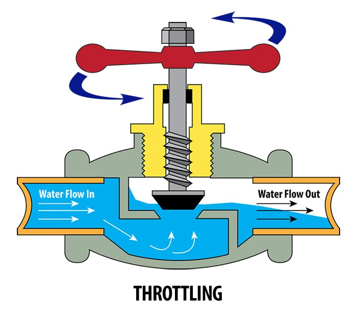
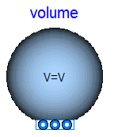
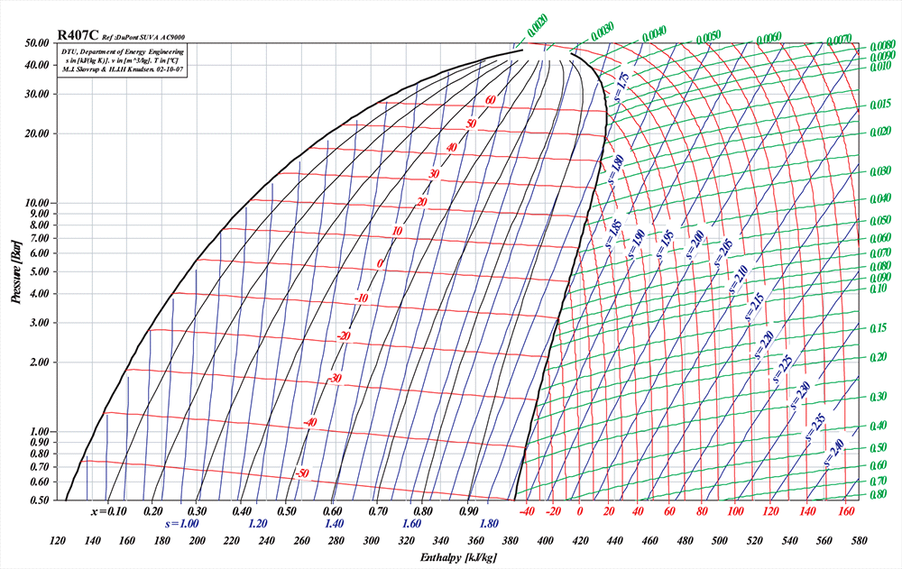
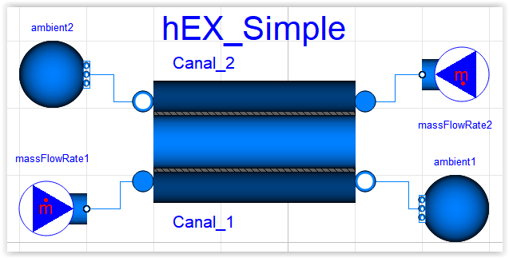

# Component Modeling

> Source: `sources/Dossier partage SE/Cours/Seance 1 Bilan energie/Day 1_Component modelling.pptx`  
> Author: Cong-Toan TRAN (2019)  
> Course: TESM (Thermodynamic Energy System Modelling)

---

## 1. 1er principe de la thermodynamique (First Law)

### 1.1 Système fermé (Closed System)
*Pas de flux de matière au travers de la frontière.*

#### Bilan d’énergie (énergies macroscopiques négligées)

$$\dot{Q} - \dot{W} = \frac{dU}{dt}$$

#### Par convention :
- **Chaleur absorbée par le système :** positif ($\dot{Q} > 0$)
- **Travail produit par le système :** positif ($\dot{W} > 0$)

#### 2 types de travail :
- **Travail externe** donné par un moyen extérieur : $\dot{W}_{\text{external}}$
- **Travail de frontière** lié à la dilatation du système : $\dot{W}_{\text{boundary}}$

$$\dot{W} = \dot{W}_{\text{external}} + \dot{W}_{\text{boundary}} \quad \text{avec} \quad \delta W_{\text{boundary}} = P \, dV \implies \dot{W}_{\text{boundary}} = P \frac{dV}{dt}$$

#### Évolutions particulières :
- **Pour une évolution à volume constant (isochore) :**  
  $\dot{W}_{\text{boundary}} = 0$

  $$\dot{Q} - \dot{W}_{\text{external}} = \frac{dU}{dt} = c_v \frac{dT}{dt}$$

  *(où $c_v$ est la chaleur spécifique à volume constant)*

- **Pour une évolution à pression constante (isobare) :**  
  $\dot{W}_{\text{boundary}} = P \frac{dV}{dt} \implies \frac{dH}{dt} = \frac{dU}{dt} + P \frac{dV}{dt}$

  $$\dot{Q} - \dot{W}_{\text{external}} = \frac{dH}{dt} = c_p \frac{dT}{dt}$$

  *(où $c_p$ est la chaleur spécifique à pression constante)*

---

### 1.2 Système ouvert (Open System)
*Échange de matière possible au travers de la frontière.*

#### Conservation de masse (Bilan de masse)

$$\dot{m}_{\text{in}} + \dot{m}_{\text{out}} = \frac{dm_{\text{system}}}{dt}$$

- **Par convention :** fluide entrant $\dot{m}_{\text{in}} > 0$, fluide sortant $\dot{m}_{\text{out}} < 0$.

#### Travail d’écoulement d’un fluide entrant ou sortant d’un système :

$$\dot{W} = \dot{W}_{\text{external}} + \dot{W}_{\text{boundary}} + \dot{W}_{\text{flow}} \quad \text{avec} \quad \dot{W}_{\text{flow}} = - \sum_{\text{ports}} P_i \dot{V}_i$$

#### Conservation d’énergie (Bilan d’énergie)

$$\dot{Q} - \left( \dot{W}_{\text{external}} + \dot{W}_{\text{boundary}} \right) + \sum_i \dot{m}_i \left( h_i + \frac{v_i^2}{2} + g z_i \right) = \frac{dU_{\text{system}}}{dt}$$

*(les énergies cinétiques $\frac{v_i^2}{2}$ et potentielles $g z_i$ sont souvent négligées)*

---

## 2. 2ème principe de la thermodynamique (Second Law)

> *« La chaleur ne passe pas spontanément d’un corps froid sur un corps chaud »*

### Inégalité de Clausius :

$$\oint \frac{\delta Q}{T} \le 0$$

- L’égalité ($= 0$) $\longrightarrow$ procédé **réversible**
- L'inégalité ($< 0$) $\longrightarrow$ procédé **irréversible**

### Définition de l’entropie :
$s$ est une variable d’état définie par :

$$dS = \left( \frac{\delta Q}{T} \right)_{\text{reversible}}$$

### Principe de la génération d’entropie :

$$\dot{S}_{\text{in}} - \dot{S}_{\text{out}} + \dot{S}_{\text{generation}} = \frac{dS_{\text{system}}}{dt}$$

Avec $\dot{S}_{\text{generation}} \ge 0$.

#### En condition stabilisée ($\frac{dS_{\text{system}}}{dt} = 0$) :

$$\sum_i \dot{m}_i s_i + \sum_j \frac{\dot{Q}_j}{T_j} + \dot{S}_{\text{generation}} = 0$$

---

## 3. Expansion Valve Modeling (Détendeur)

### Modeling Assumptions:
- No mechanical work $\longrightarrow \dot{W} = 0$
- Small external surface $\longrightarrow \dot{Q} = 0$
- Small control volume $\longrightarrow E_{\text{system}}, m_{\text{system}}$ neglected
- Kinetic energy neglected

### Energy Balance:

$$\dot{Q}_{\text{net,in}} - \dot{W}_{\text{net,out}} + \sum_i \dot{m}_i \left( h_i + \frac{v_i^2}{2} \right) = \frac{dE_{\text{system}}}{dt} \implies h_{\text{in}} \approx h_{\text{out}}$$

Quasi-isenthalpic expansion process:

$$h_{\text{in}} \approx h_{\text{out}}$$

### Flow Rate Model:
Flow rate controlled by the opening level of the valve:

$$\dot{m} = k \cdot \text{opening} \cdot \Delta p$$

- $k$ : parameter of the valve, generally determined thanks to nominal working points
- $\text{opening}$ : between $0$ (closed) and $1$ (completely opened)

---

## 4. Closed Tank (Réservoir fermé)

  

### Modeling Assumptions:
- No mechanical work $\longrightarrow \dot{W} = 0$
- Kinetic and potential energies neglected
- Finite control volume (mass and internal energy accumulation are significant)
- External heat transfer with surroundings: $\dot{Q} = K \cdot S \cdot (T_{\text{tank}} - T_{\text{amb}})$

### Governing Equations:

#### Mass Balance:

$$\sum_i \dot{m}_i = \frac{dM_{\text{tank}}}{dt}$$

#### General Energy Equation:

$$\dot{Q} - \left( \dot{W}_{\text{external}} + \dot{W}_{\text{boundary}} \right) + \sum_i \dot{m}_i \left( h_i + \frac{v_i^2}{2} + g z_i \right) = M_{\text{tank}} \frac{du_{\text{tank}}}{dt}$$

#### Simplified Energy Balance for the Closed Tank:

$$\dot{Q} + \sum_i \dot{m}_i h_i = M_{\text{tank}} \frac{du_{\text{tank}}}{dt} \quad \text{with} \quad \dot{Q} = K \cdot S \cdot (T_{\text{tank}} - T_{\text{amb}})$$

---

## 5. Compression Modeling (Compresseurs)

### 5.1 Ideal and Real Processes

---

### 5.2 Isentropic Efficiency

#### Modeling Assumptions:
- Small external surface $\longrightarrow \dot{Q} = 0$
- Small internal volume $\longrightarrow E_{\text{system}}, m_{\text{system}}$ neglected
- Kinetic energy neglected

#### Model:
- **Adiabatic process:**

  $$\dot{W}_{\text{net,out}} = \sum_i \dot{m}_i h_i = \dot{m}(h_{\text{out}} - h_{\text{in}})$$

- **Isentropic efficiency (also called adiabatic efficiency) supposed to be known:**

  $$\eta_{\text{comp}} = \frac{w_{\text{isentropic}}}{w_{\text{real}}} \approx \frac{h_{\text{out, isentropic}} - h_{\text{in}}}{h_{\text{out, real}} - h_{\text{in}}}$$

- **For a (liquid) pump :** close to 1 (quasi-isentropic)
- **For a (vapor) compressor :** $h$ depends essentially on working conditions $\longrightarrow h(T, p)$ needs to be known (via experimental tests or fluid database)

---

### 5.3 How to Calculate the Flow Rate?

#### Volumetric Type
*(Ex: reciprocating and rotary compressors)*
- Rotational speed: number of turns of the rotor per second ($f_{\text{rotor}}$)
- Flowrate depends on swept volume $V_s$, rotational speed and the inlet condition:

  $$\dot{V} = V_s \cdot f_{\text{rotor}}$$

  $$\dot{m} = \dot{V} \cdot \rho_{\text{inlet}}$$

#### Dynamic Type
*(Ex: centrifugal compressor / centrifugal turbine)*
- A specific correlation between the flowrate and working conditions is required.
- Expansion (turbine) modeling can be done using a similar method:
- **Example of correlation for a centrifugal turbine:**

  $$\dot{m} = K \sqrt{\frac{p_{\text{in}}^2 - p_{\text{out}}^2}{T_{\text{in}}}}$$

  *(where $K$ is the characteristic constant of the component)*

---

## 6. Analysis of Heat Exchanger (HEX)

### 6.1 Simplified Case

Heat exchangers allow the exchange of heat between 2 fluids of different temperatures without mixing them.

#### Assumptions:
- Thermodynamic properties being constant
- Wall thickness neglected
- Exchange surfaces with the wall being the same

#### Local Equations:

$$\delta \dot{Q} = U (T - t) \, dA = -C \, dT = c \, dt \quad \text{with} \quad dA = P \, dx \quad \text{and} \quad \frac{1}{U} = \frac{1}{H} + \frac{1}{h}$$

*(where $C, c$ are the heat capacity rates in $\text{W/K}$ or $\text{J/(K}\cdot\text{s)}$)*

#### Temperature Difference Along the Exchanger:

$$\Delta T(x) = \Delta T_0 \exp\left( - U P \left[ \frac{1}{C} + \frac{1}{c} \right] x \right) \quad \text{with} \quad \Delta T = T - t$$

#### Overall Heat Exchange Rate and Log Mean Temperature Difference (LMTD / DTLM):

$$\dot{Q} = U A \, \Delta T_{\text{LM}} \quad \text{with} \quad \Delta T_{\text{LM}} = \frac{\Delta T_{\text{left}} - \Delta T_{\text{right}}}{\ln\left( \frac{\Delta T_{\text{left}}}{\Delta T_{\text{right}}} \right)}$$

---

### 6.2 Parallel-Flow and Counter-Flow Types

These results are still correct in the following conditions:
- The exchange surfaces are different
- The wall conduction is considerable
- Counter-flow ($a = -1$) or parallel-flow ($a = 1$)

$$\dot{Q} = (UA) \, \Delta T_{\text{LM}} \quad \text{with} \quad \Delta T_{\text{LM}} = \frac{\Delta T_{\text{left}} - \Delta T_{\text{right}}}{\ln\left( \frac{\Delta T_{\text{left}}}{\Delta T_{\text{right}}} \right)}$$

Where $a$ is the **circulation indicator** ($a = -1$ for counter-flow, $a = +1$ for parallel-flow):

$$\Delta T(x) = \Delta T_0 \exp\left( - \frac{UA}{L} \left[ \frac{1}{C} + \frac{1}{a \, c} \right] x \right) \quad \text{avec} \quad \frac{1}{UA} = \frac{1}{H S} + R_p + \frac{1}{h s}$$

---

### 6.3 Heat Exchanger Modeling for Design (Sizing Mode)

Modeling a heat exchanger depends on the objectives:
- **Objective of simulation:** the system already exists (known geometry $A, UA$, calculate $T_{\text{out}}$)
- **Objective of design:** the system is to be sized (known duty and target temperatures/pinch, calculate $A, UA$)

#### Design Equations:

$$\dot{Q} = \dot{m}_1 (h_{1b} - h_{1a})$$

$$\dot{Q} = \dot{m}_2 (h_{2a} - h_{2b})$$

$$\dot{Q} = UA \, \Delta T_{\text{LM}}$$

- Additional constraint: given temperatures, pinch point, etc.
- $\longrightarrow UA$ calculated.
- $\longrightarrow A, a$ calculated for given heat transfer coefficients $U, u$ and surface ratio $A/a$.

---

### 6.4 Pinch of a Heat Exchanger

- **Definition:** The pinch is defined as the **minimum difference** of the 2 fluid temperatures along the heat exchanger ($\Delta T_{\text{pinch}}$).
- In the case of **no phase change**, the pinch location is at **one of the two sides** of the heat exchanger ($x = 0$ or $x = L$).
- Pinch value results directly from the heat exchanger surface area (i.e. the HEX capital cost).
- In industrial practice, a heat exchanger is sized by fixing a design pinch value.

---

### 6.5 Heat Exchanger Modeling for Simulation ($\varepsilon - \text{NTU}$ Method)

When simulating an existing heat exchanger, the outlet temperatures $T_{\text{out}}$ must be determined:
- Using $\dot{Q} = UA \Delta T_{\text{LM}}$ directly requires solving an implicit logarithmic equation.
- The **NUT / NTU method** allows calculating $T_{\text{out}}$ via explicit, sequential calculations:

$$\text{NUT} = \frac{UA}{C_{\min}}$$

$$\text{effectiveness } \varepsilon = f(\text{NUT}, C_{\min}/C_{\max})$$

---

### 6.6 Effectiveness of a Heat Exchanger ($\varepsilon$)

- **Definition:** 

  $$\varepsilon = \frac{\dot{Q}_{\text{exchanged}}}{\dot{Q}_{\max}} = \frac{t_0 - t_L}{T_0 - t_L}$$

- Effectiveness results from the HEX surface area (i.e. the HEX cost).
- **Thermodynamic comparison:**

  $$\varepsilon_{\text{counter-flow}} > \varepsilon_{\text{parallel-flow}}$$
