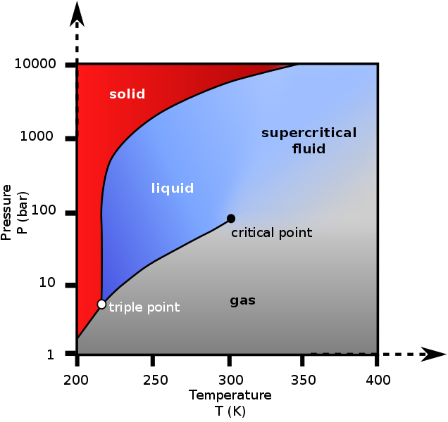
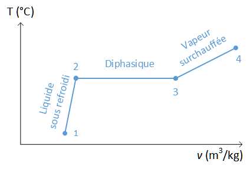
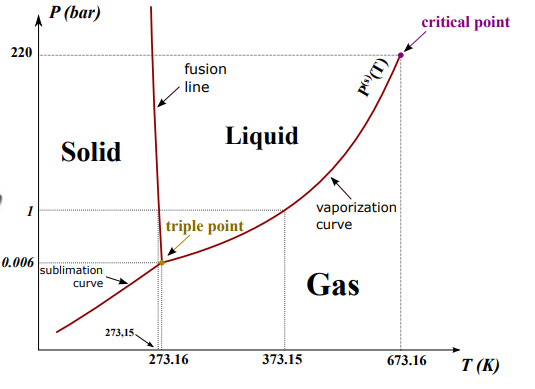
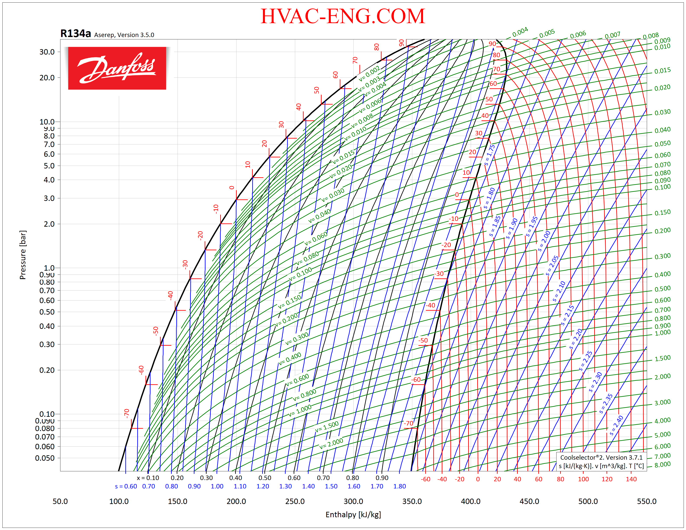
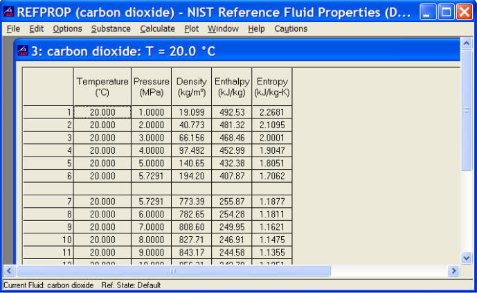
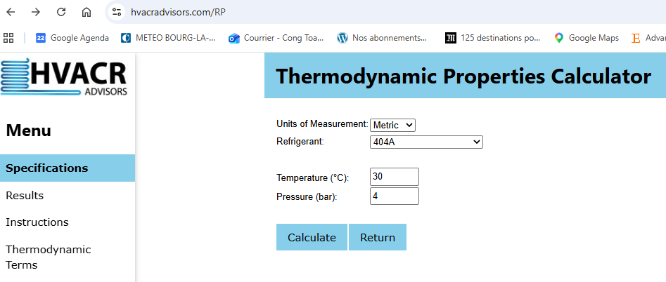

# Thermodynamic Fluid Properties

> Source: `sources/Dossier partage SE/Cours/Seance 1 Bilan energie/Day 1_Fluid properties.pptx`  
> Author: Cong Toan TRAN (2022)  
> Course: TESM (Thermodynamic Energy System Modelling)

---

## 1. Thermodynamic Properties: Reminders

- **Intensive property:** A physical property that does *not* depend on the system size or the amount of material in the system (e.g., temperature $T$, pressure $P$, specific volume $v$, specific enthalpy $h$, specific entropy $s$).
- **Extensive property:** A physical property that is additive for subsystems; it scales directly with the size/mass of the system (e.g., total volume $V$, total enthalpy $H$, total entropy $S$, total internal energy $U$).

### Fundamental Thermodynamic Variables

| Variable | Symbol | SI Unit | Nature |
| :--- | :---: | :---: | :--- |
| **Temperature** | $T$ | $\text{K}$ or $^\circ\text{C}$ | Intensive |
| **Pressure** | $P$ | $\text{Pa}$ ($\text{bar}$) | Intensive |
| **Volume** | $V$ | $\text{m}^3$ | Extensive |
| **Enthalpy** | $H$ | $\text{J}$ | Extensive |
| **Entropy** | $S$ | $\text{J/K}$ | Extensive |
| **Internal Energy** | $U$ | $\text{J}$ | Extensive |
| **Specific Heat Capacity** | $c_p$, $c_v$ | $\text{J}/(\text{kg}\cdot\text{K})$ | Intensive |
| **Specific Enthalpy** | $h$ | $\text{J/kg}$ | Intensive |
| **Specific Entropy** | $s$ | $\text{J}/(\text{kg}\cdot\text{K})$ | Intensive |
| **Specific Volume** | $v$ | $\text{m}^3/\text{kg}$ | Intensive |

---

## 2. Properties of a Pure Fluid

Pure substances typically transition across different thermodynamic regimes:
- **Subcooling liquid** (liquid below saturation temperature at a given pressure)
- **Diphasic mixture** (liquid-vapor equilibrium under the saturation dome)
- **Overheating / Superheated vapor** (vapor above saturation temperature)
- **Supercritical phase** (state beyond the critical point: $T > T_c$, $P > P_c$)

<div align="center">
  
  &nbsp;&nbsp;&nbsp;&nbsp;
  
</div>

### Saturated Mixture & Vapor Quality
Under the saturation dome, the **vapor quality** $x$ (vapor mass fraction) is defined by:

$$x = \frac{m_{\text{vapour}}}{m_{\text{total}}} \quad (0 \le x \le 1)$$

For a given intensive variable $z$ (such as specific enthalpy $h$, specific volume $v$, or specific entropy $s$):

$$z = (1 - x) \, z_{\text{liq}} + x \, z_{\text{vap}}$$

### Equations of State (EOS)
An equation of state relates state variables $(P, v, T)$:
- **Perfect / Ideal Gas:**

  $$P v = \frac{R}{M} T$$

- **Real Gas (e.g. Van der Waals):**

  $$\left( P + \frac{a}{v^2} \right)(v - b) = \frac{R}{M} T$$

---

## 3. Degrees of Freedom (Variance)

The number of degrees of freedom ($F$) is the number of intensive variables which are independent of each other.

### Gibbs Phase Rule

$$F = N - \Phi + 2$$

Where:
- $F$ : degree of freedom (variance)
- $N$ : number of components
- $\Phi$ : number of phases in thermodynamic equilibrium

### Examples:

| System Configuration | $N$ | $\Phi$ | Degree of Freedom $F$ | Meaning |
| :--- | :---: | :---: | :---: | :--- |
| **Single component / Single phase** | 1 | 1 | $F = 1 - 1 + 2 = \mathbf{2}$ | Specifying two intensive variables (e.g. $P, T$ or $P, h$) completely determines the thermodynamic state. |
| **Single component / Two phase** | 1 | 2 | $F = 1 - 2 + 2 = \mathbf{1}$ | Pressure and temperature are coupled ($T = T_{\text{sat}}(P)$). Specifying 1 variable fixes the saturation line. |
| **Single component / Three phase** | 1 | 3 | $F = 1 - 3 + 2 = \mathbf{0}$ | Invariant state (triple point). |
| **Binary system / Single phase** | 2 | 1 | $F = 2 - 1 + 2 = \mathbf{3}$ | Requires three independent intensive variables (e.g. $T, P,$ and molar fraction). |

<div align="center">
  
</div>

---

## 4. How to Calculate a Thermodynamic Property

1. **Calculate the degree of freedom** ($F$).
2. **Identify the appropriate state variables** which are known (e.g., $(P, T)$, $(P, h)$).
3. **Use one of the two following options:**
   - **Property diagrams:** $P-h$ diagram, $T-s$ diagram, $P-v$ diagram, Mollier $h-s$ diagram.
   - **Software and calculation tools:** Digital libraries and calculators (NIST REFPROP, CoolProp, Caldis, or web tools).

---

## 5. Thermodynamic Diagrams & Software Tools

### Pressure-Enthalpy ($p-h$) Diagram



### NIST REFPROP



> **Exercise:** *Estimate the cost of gas to heat the water used during a shower!*

### Free Online Property Tool
- Interactive web tool: `https://irc.wisc.edu/properties/`



---

## 6. Calling Thermodynamic Properties in Python

### Directly from `CoolProp`

```python
from CoolProp.CoolProp import PropsSI

p = 1e5
T = 10 + 273.15
h = PropsSI("H", "P", p, "T", T, "Air")
print(f"Air enthalpy at 1 bar, 10°C: {h:.2f} J/kg")
```

### From `Caldis` (convenience wrapper)

```python
from caldis.fluids.coolprop_backend import CoolPropBackend

be_air = CoolPropBackend("Air")
p = 1e5
T = 10 + 273.15
h = be_air.h_pt(p, T)
print(f"Caldis air enthalpy: {h:.2f} J/kg")
```
