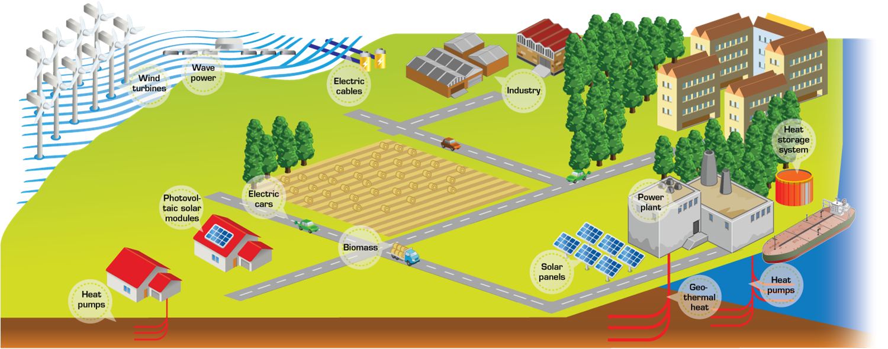
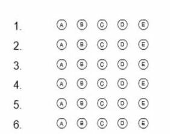

# Thermodynamics Energy System Modelling (TESM) Course

> Source: `sources/Dossier partage SE/Cours/Seance 1 Bilan energie/Day 1_Intro TESM Course.pptx`  
> Author: Cong Toan TRAN (2019)  
> Contact: `cong-toan.tran@mines-paristech.fr`

---

## 1. Energy Systems

- **Everywhere in human society:** Energy systems provide fundamental needs of daily life (power, heating, cooling, mobility, industrial transformation).
- **Environmental challenge:** Energy systems are the main greenhouse gas (GHG) emitters worldwide.

---

## 2. Objectives of the Course

### Core Learning Objectives
- Master the **working principles** of thermodynamic energy systems.
- Apply systematic **performance analysis methods**.
- Perform system **design and component sizing**.
- Carry out **stationary and dynamic simulation**.
- Identify potential for **performance improvement via exergy analysis**.

### Thermodynamic Cycles Studied
1. **Refrigeration and Heat Pumps (HVAC)**
2. **Gas Turbine (Brayton cycle)**
3. **Water-Steam Cycle (Rankine / Hirn cycle)**
4. **Combined Cycles (CCGT)**
5. **Cogeneration (CHP - Combined Heat and Power)**
6. Other advanced cycles explored during student project sessions.

---

## 3. Planning & Course Organization

- Mix of lectures, theoretical derivations, numerical exercises, and simulation projects.
- Hands-on modeling using Python thermodynamic backends (CoolProp, Caldis) and OpenModelica.

---

## 4. Evaluation & Grading Scheme

The final evaluation is broken down into three components:

| Component | Weight | Visual | Description |
| :--- | :---: | :---: | :--- |
| **Multiple Choice Examination** | **/50** |  | Platform Moodle, all course materials allowed |
| **Project** | **/40** |  | Written report + simulation model |
| **Course Attendance** | **/10** |  | Active presence in lectures and exercise sessions |

---

## 5. Multiple Choice Examination Guidelines

The final exam is held on the **Moodle** platform with open course materials:
- **Scope:**
  - Description of the studied thermodynamic cycles.
  - Comparison between ideal and real cycles.
  - Calculation of system efficiencies and balances.
  - Exergetic analysis.
  - *Note:* No direct questions testing OpenModelica syntax.
- **Scoring Rules:**
  - 1 question = 1 point (unless explicitly stated otherwise).
  - **No penalty** points for incorrect answers.
- **Answer Format:**
  - If a question allows multiple choices, it has more than one correct answer.
  - For numerical inputs: provide at least **3 significant digits**.
  - Both decimal point (`.`) and comma (`,`) are accepted as decimal separators.
  - Questions can be skipped and revisited at any time before the deadline.
  - Answers can be updated freely until time runs out.
- **Reference Calculator:**
  - Recommended online thermodynamic property calculator: [UW-Madison IRC Properties Tool](https://irc.wisc.edu/properties/)

---

## 6. Course Materials & References

- Lecture slides (PDF / PPTX)
- Exercise sheets and correction guides
- Modelica library: `EnergySystems`
- Python modeling scripts (`Caldis`, `CoolProp`)
- Reference textbook: *Thermodynamics Energy System Modelling* (available in the cloud shared folder)
