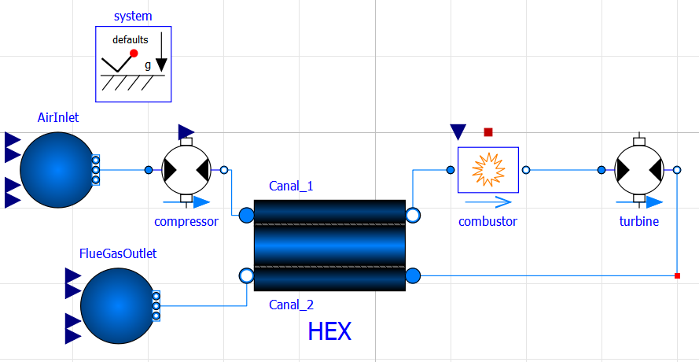
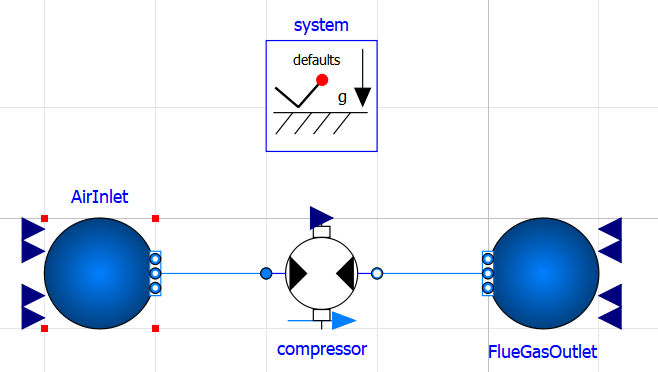
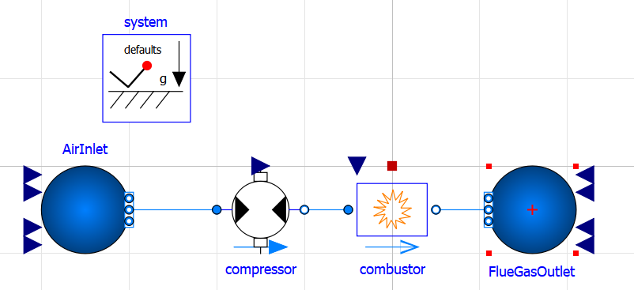
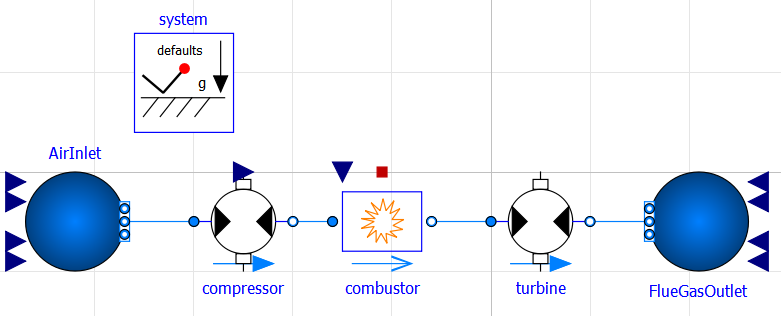
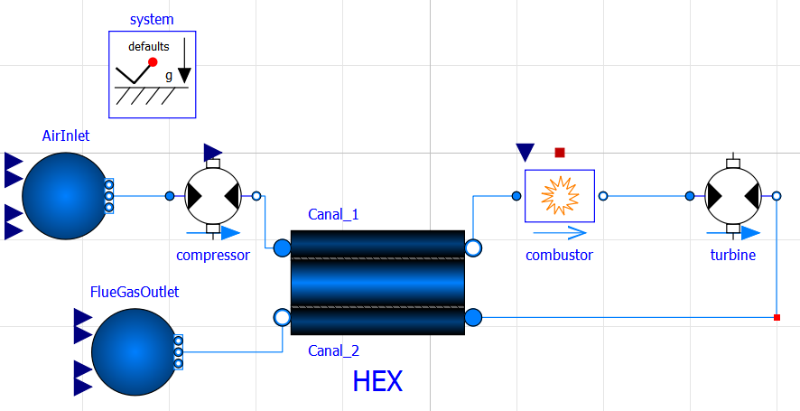

# Exercise: Gas Turbine

> Source: `sources/Dossier partage SE/Cours/Seance 1 Bilan energie/Gas Turbine.docx`

A gas turbine is a thermodynamic machine whose role is to produce mechanical energy from thermal energy. In most applications, the gas turbine is coupled with an alternator to produce electricity.

---

## Part 1

From a thermodynamic point of view, there are several types of gas turbine. The objective of this part is to model the most classical type based on the Brayton cycle (figure below). In particular, the working fluid (gas) undergoes three successive transformations: compression, combustion and expansion. In this exercise, we will consider a gas turbine where the high and low pressures are 1 and 15 bar. The development of the model should be done step by step.



---

### Step 1: Compression Phase

In this step, we aim to model the compression phase. Develop the model below using the following classes:

```python
from caldis.components import FluidBoundary
from caldis.components import Compressor
```

The working fluid is supposed to be the ambient air:

```python
be_air = CoolPropBackend("Air")
```

at $1\text{ bar}$ and $20\text{ }^\circ\text{C}$.

The compressor has a mass flowrate of $1\text{ kg/s}$.



#### Question 1
First, it is assumed that the isentropic efficiency of the compressor is equal to 1. What are the compressor outlet temperature and the compressor power? The actual efficiency is 0.86. What are the temperature and the power? Comment on the results.

*In what follows, the isentropic efficiency of the compressor keeps 0.86.*

---

### Step 2: Adding the Combustion Chamber

Create another system, named `gt_step2_combustor`, where we add a combustion chamber using the following class:

```python
from caldis.components import CombustionChamber
```

Due to a technical constraint, the flue gas temperature at the combustor outlet does not exceed the limit temperature of $1400\text{ K}$. We suppose that the relative pressure loss in the combustor chamber is $4\%$, the fuel used is methane with a lower heating value LHV of $50\times 10^6\text{ J/kg}$. The fuel has a temperature of $25\text{ }^\circ\text{C}$ and pressure of $15\text{ bar}$.



#### Question 2
What is the fuel mass flowrate?

---

### Step 3: Complete Cycle with Turbine

We complete the cycle by adding a turbine whose class is:

```python
from caldis.components import Turbine
```

The turbine has an isentropic efficiency of 0.89.



#### Question 3
What are the mechanical power generated by the turbine and the power consumed by the compressor?

#### Question 4
What is the efficiency of the cycle? What is the efficiency of the ideal Brayton cycle working at the same conditions? Explain the difference.

---

## Part 2: Heat Recovery (Recuperation)

#### Question 5
What is the flue gas temperature at the turbine outlet?

Most of the available energy is lost in the flue gas at very high temperatures. To improve the performance of the system, a possible solution is to recover the fatal heat and to reinject it into the system. We therefore aim to model the cycle below. Create another system and use the following class of heat exchanger:

```python
from caldis.components import SizingHX
```



The effectiveness of the heat exchanger is 0.7 and remember that we need to respect the temperature constraint (limited to $1400\text{ K}$).

#### Question 6
What is the efficiency of the system with recuperation? What is the pinch value of the heat exchanger?

The efficiency of the system depends on the amount of recovered heat, and therefore the size of the heat exchanger. Study the evolution of the efficiency when the heat exchanger size increases.

#### Question 7
Comment on the evolution of the efficiency. Compare its maximum value with the theoretical efficiency at the same working conditions.

---

## Answers

### Question 1
- **Isentropic compression:** $T = 354\text{ }^\circ\text{C}$, $P = 343\text{ kW}$
- **Real compression ($\eta = 0.86$):** $T = 407\text{ }^\circ\text{C}$, $P = 399\text{ kW}$

### Question 2
- **Fuel Mass Flowrate:** $\dot{m}_{\text{fuel}} = 0.0167\text{ kg/s}$

### Question 3
- **Turbine Power:** $P_{\text{turbine}} = 719\text{ kW}$
- **Compressor Power Consumed:** $P_{\text{compressor}} = 399\text{ kW}$

### Question 4
- **Efficiency of the real cycle:** $37\%$

### Question 5
- **Flue gas outlet temperature:** $T = 516\text{ }^\circ\text{C}$

### Question 6
- **Efficiency with recuperation:** $40.9\%$
- **Pinch value:** $\Delta T_{\text{pinch}} = 30\text{ K}$

### Question 7
- *(Open comment on efficiency evolution vs HEX size/pinch and comparison with Carnot / theoretical Brayton limit)*
