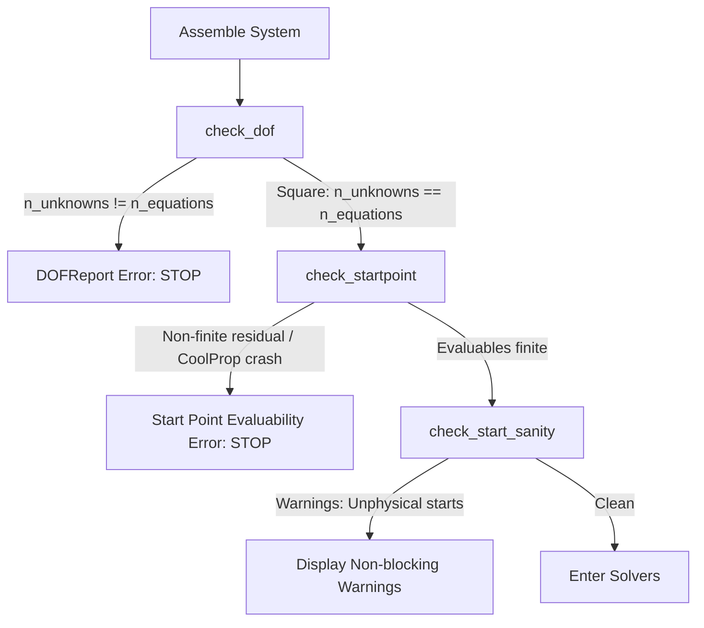

# Degrees of Freedom (DOF)

## Why DOF Verification Matters

In physical systems simulation, one of the most frustrating experiences is encountering a solver failure that simply reports:

```text
Singular matrix in LU factorization
```

In almost all cases, this is not caused by numerical instability—it is caused by a **modeling mismatch**:
- **Under-specified system**: Too few boundary conditions or equations specified. For example, a compressor is defined without fixing its discharge pressure, pressure ratio, or mass flow rate.
- **Over-specified system**: Too many constraints applied to the same stream. For example, setting pressure on both the inlet and outlet of a frictionless pipe or fixing both inlet and outlet temperatures on a fixed-duty heater.

Caldis eliminates this ambiguity before invoking the solver using **structural DOF preflight**.

---

## The Preflight Mechanism

Before running any Newton iteration or homotopy continuation, `solve(sys)` and `simulate(sys)` run `preflight(sys)`.



### 1. Counting Rule

For a system with components $C$, connections $K$, and system constraints $S$:

$$\text{DOF} = N_{\text{unknowns}} - N_{\text{equations}}$$

where:

$$N_{\text{unknowns}} = \sum_{c \in C} \text{len}(c.\text{all_variables}())$$

$$N_{\text{equations}} = \sum_{c \in C} \text{len}(c.\text{residuals}()) + \sum_{k \in K} \text{len}(k.\text{residuals}()) + \text{len}(S)$$

### 2. DOF Status Classifications

| DOF Value | Status | Diagnostic Message | Action Required |
| :--- | :--- | :--- | :--- |
| $\text{DOF} = 0$ | **Square (OK)** | `[DOF ok] N unknowns, N equations — système carré.` | Proceed to start check. |
| $\text{DOF} > 0$ | **Under-specified** | `[DOF sous-spécifié] N unknowns, M equations : il manque K condition(s)...` | Add a boundary spec (`FluidBoundary`) or `fix_port`. |
| $\text{DOF} < 0$ | **Over-specified** | `[DOF sur-spécifié] N unknowns, M equations : K équation(s) de trop...` | Remove redundant pressure/temperature specs. |

---

## Fixing Degrees of Freedom

### Using `fix_port`

The recommended approach to close free degrees of freedom is the `fix_port` helper:

```python
from caldis.solvers.autostart import fix_port

# Pin pressure and seed start value
fix_port(sys, comp.out, p=6.0e5)

# Pin temperature (converts to enthalpy via port backend)
fix_port(sys, hex.cold_out, T=350.15)
```

`fix_port` performs two critical tasks simultaneously:
1. Adds a system residual: $p_{\text{port}} - p_{\text{target}} = 0$
2. Seeds `port._p.start = p_target` with high provenance so autostart knows the value.

### Arbitrary Constraints

For inter-component relationships (e.g., maintaining a constant pressure ratio or temperature difference):

```python
# Impose pressure ratio: p_out = 4.5 * p_in
sys.add_constraint(
    lambda: comp.out.p - 4.5 * comp.inl.p,
    name="compressor_pressure_ratio"
)
```

