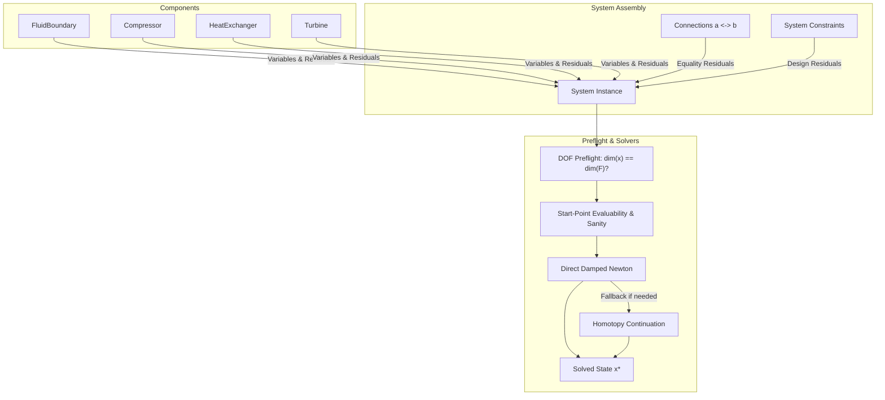

# Architecture & Overview

## Philosophical Foundations

Most process and thermal simulators operate in a **causal** (input $\rightarrow$ output) fashion or rely on complex symbolic restructuring (e.g., standard Modelica engines) that often yields cryptic errors like *"system structurally singular"* when boundary conditions are slightly altered.

**Caldis** takes an **equation-oriented, acausal, residual-based approach**:

1. **No component calculates an output**: A component does not calculate $T_{\text{out}}$ given $T_{\text{in}}$. Instead, it declares equations $F(x) = 0$ that describe its physical balance laws.
2. **Global System Assembly**: The system aggregates all component variables into a single state vector $x \in \mathbb{R}^n$ and gathers all physical and topological residuals into $F(x) \in \mathbb{R}^m$.
3. **Multi-Stage Preflight**: Prior to invoking nonlinear solvers, the system runs explicit degree-of-freedom checking, evaluability checks, and physical sanity bounds.

---

## The Core Data Model

### 1. Variables (`Variable`)
A `Variable` represents a single scalar unknown in the system:
- **`start`**: Initial guess for the iterative solver.
- **`value`**: Current numeric value.
- **`lower` / `upper`**: Optional physical bounds (e.g., $p \ge 0$, $T \ge 0$).
- **`scale`**: Characteristic physical scale used to normalize Jacobian columns.
- **`differential`**: Flag set to `True` for dynamic state variables (e.g., mass $M$, internal energy $U$, wall temperature $T_{\text{wall}}$) which carry a `.der` attribute ($\dot{x}$).

### 2. Fluid Ports (`FluidPort`)
Fluid interaction between components occurs via ports. Every `FluidPort` owns exactly three core variables:
- `_p`: Pressure in Pascals ($\text{Pa}$).
- `_h`: Specific enthalpy in Joules per kilogram ($\text{J/kg}$).
- `_mdot`: Mass flow rate in kilograms per second ($\text{kg/s}$).

Thermodynamic properties ($T, s, \rho, x$) are exposed as dynamic read-only properties calculated via the attached `FluidBackend`.

### 3. Connections (`Connection`)
When two ports `port_a` and `port_b` are connected via `sys.connect(port_a, port_b)`:
- Pressure equality: $p_a - p_b = 0$
- Enthalpy equality: $h_a - h_b = 0$
- Mass balance: $\dot{m}_a + \dot{m}_b = 0$ (omitted when `close_loop=True`).

### 4. Components (`Component`)
A `Component` can be a leaf (defining its own residual list) or a composite (embedding child components). It provides:
- `all_variables()`: Recursive list of internal and port variables.
- `residuals()`: Recursive list of equation residuals $F_i(x)$.
- `residual_names()`: Human-readable diagnostic labels for each equation.
- `update_outputs()`: Calculates post-convergence engineering outputs (power $\dot{W}$, duty $\dot{Q}$, pressure ratios, efficiencies).
- `start_sanity()`: Pre-solve checks warning against unphysical start values.
- `physical_check()`: Post-solve checks detecting unphysical converged states (such as temperature crossings in heat exchangers).

