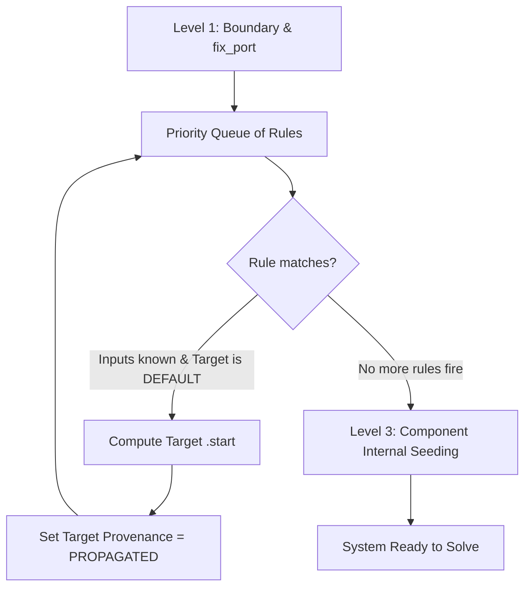

# Start Point & Provenance System

Nonlinear algebraic solvers for thermodynamic cycles are notoriously sensitive to initial guesses ($x_0$). An arbitrary initial point can easily cause CoolProp to evaluate properties in two-phase regions with zero flow or unphysical negative temperatures, triggering crashes.

Caldis provides a **three-tier start initialization and rule propagation engine** (`caldis.solvers.autostart`).

---

## The Provenance Hierarchy

To ensure manual user overrides are never clobbered by automatic propagation, every port variable tracks a **provenance level**:

```
0: DEFAULT   <   1: PROPAGATED   <   2: HINT   <   3: BOUNDARY
```

- **`DEFAULT (0)`**: Universal safe baseline initialized by the fluid backend (typically 1 bar, 283.15 K).
- **`PROPAGATED (1)`**: Inferred by topological rules (e.g., flow continuity across a valve or heater).
- **`HINT (2)`**: Explicitly provided by the user using `sys.set_start_port(...)` or `sys.set_start(...)`.
- **`BOUNDARY (3)`**: Imposed boundary specifications from `FluidBoundary` or `fix_port`.

Propagation **only** writes into a variable if its current state is `DEFAULT (0)`. It will never overwrite a `HINT` or `BOUNDARY`.

---

## How Autostart Propagation Works

`autostart(sys, verbose=False)` executes a fixpoint loop over direction-agnostic rules until no more variables can be updated:



### Propagation Rules

1. **Connections**:
   - $p_a \leftrightarrow p_b$
   - $h_a \leftrightarrow h_b$
   - $\dot{m}_a \leftrightarrow -\dot{m}_b$
2. **Two-Port Components (Valves, Heaters, Turbines, Compressors)**:
   - Flow continuity: $\dot{m}_{\text{in}} = -\dot{m}_{\text{out}}$
   - Enthalpy preservation across valves (isenthalpic): $h_{\text{out}} = h_{\text{in}}$
   - Known pressure drops across heaters: $p_{\text{out}} = p_{\text{in}} - \Delta p$
3. **Splitters & Mixers**:
   - Splitter: $p_{\text{out}} = p_{\text{in}}$, $h_{\text{out}} = h_{\text{in}}$

---

## Manual Seeding Hints

When autostart requires guidance (e.g., across machines where enthalpy changes significantly):

### `sys.set_start_port`
Sets a start hint on a specific port:

```python
# Sets pressure and converts 450 °C into enthalpy using the port backend
sys.set_start_port(comp.out, p=12.0e5, T=450 + 273.15)
```

### `sys.set_start`
Applies hints across all fluid ports of a component:

```python
# Apply hint to all ports on the cold side of a heat exchanger
sys.set_start(recup, p=10.0e5, T=350.15, side="cold")
```

### `sys.set_start_internal`
Applies initial values to internal discretised variables (such as cell temperatures or wall profiles in `HXSim`):

```python
sys.set_start_internal(hx_sim, "Tw", 400.0)
```

