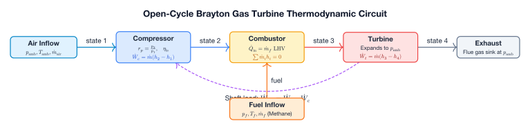

# Combustion & Heaters

Components for stream thermal heating/cooling and fuel combustion.

---

## SimpleHeater

`caldis.components.combustion.heater.SimpleHeater` models a thermal duty source or sink on a single fluid stream with optional pressure drop.

### Constructor & Parameters

```python
SimpleHeater(name, backend, Qdot=None, dp=0.0, T_source=None)
```

| Parameter | Type | Default | Units | Description & Constraints |
| :--- | :--- | :--- | :--- | :--- |
| `name` | `str` | *required* | — | Component identifier string. |
| `backend` | `FluidBackend` | *required* | — | Fluid thermodynamic properties backend. |
| `Qdot` | `float` or `None` | `None` | $\text{W}$ | Thermal duty. **$\dot{Q} > 0$ heats**, **$\dot{Q} < 0$ cools**. If `None`, $\dot{Q}$ is instantiated as an internal unknown `Variable`. |
| `dp` | `float` | `0.0` | $\text{Pa}$ | Imposed constant pressure drop ($p_{\text{out}} = p_{\text{inl}} - \Delta p$). |
| `T_source` | `float` or `None` | `None` | $\text{K}$ | Temperature of the external thermal reservoir. Set to `float('inf')` for pure work-grade / electric resistance heating. Required for exergy balance. |

### Operating Modes & Unknowns

1. **Parameter Mode (`Qdot` is provided as a `float`)**:
   - $\dot{Q}$ is fixed as an input parameter in `params["Qdot"]`.
   - The outlet enthalpy $h_{\text{out}}$ adapts according to the specified heat duty.
2. **Sizing / Unknown Mode (`Qdot=None`)**:
   - Creates an internal unknown variable `self._Qdot` (`start=0.0`, `scale=1e3`).
   - The system must provide one closing constraint (e.g., pinning outlet temperature via `fix_port(sys, heater.out, T=...)`).

### Ports

| Port Name | Direction | Type | Description |
| :--- | :--- | :--- | :--- |
| `inl` | Inlet | `FluidPort` | Fluid entry port. |
| `out` | Outlet | `FluidPort` | Fluid exit port. |

### Governing Equations & Residuals

The component contributes 3 residuals (`residuals()`):

1. **Mass conservation (`"mass"`)**:
   $$\dot{m}_{\text{inl}} + \dot{m}_{\text{out}} = 0$$
2. **Pressure relation (`"dp"`)**:
   $$p_{\text{out}} - (p_{\text{inl}} - \Delta p) = 0$$
3. **Energy balance (`"energy"`)**:
   $$\dot{m}_{\text{inl}} (h_{\text{out}} - h_{\text{inl}}) - \dot{Q} = 0$$

### Post-Solve Outputs & Exergy

- **`heater.Qdot`**: Current heat duty ($\text{W}$).
- **Entropy Generation (`heater.entropy_generation()`)**:
  $$\dot{S}_{\text{gen}} = \dot{m}_{\text{inl}} (s_{\text{out}} - s_{\text{inl}}) - \frac{\dot{Q}}{T_{\text{source}}}$$
  (With $T_{\text{source}} = \infty$, $\dot{Q}/T_{\text{source}} = 0$).
- **Exergy Balance (`heater.exergy_balance(T0, p0)`)**:
  $$\dot{X}_Q = \dot{Q} \left(1 - \frac{T_0}{T_{\text{source}}}\right)$$
  $$\Delta \dot{X}_{\text{stream}} = \dot{X}_{\text{out}} - \dot{X}_{\text{inl}}$$
  $$\dot{X}_{\text{dest}} = \dot{X}_Q - \Delta \dot{X}_{\text{stream}} = T_0 \dot{S}_{\text{gen}}$$
  *Note: Returns `None` if `T_source` is not configured.*

### Pre-Solve Sanity Checks (`_own_start_sanity`)

- **Inlet mass flow**: $|\dot{m}_{\text{inl}}| > 10^{-12}\text{ kg/s}$ (warns if near zero because outlet enthalpy becomes undetermined).

---

## CombustionChamber

`caldis.components.combustion.combustion_chamber.CombustionChamber` models a gas-turbine combustor with rigorous mass and energy balances referenced to standard reference conditions.

### System Context: Brayton Gas Turbine Circuit



### Constructor & Parameters

```python
CombustionChamber(
    name, backend_air, backend_fuel,
    LHV=50.0e6, eta_comb=1.0, dp_rel=0.04,
    AFR_stoich=17.2, T_ref=298.15, p_ref=101325.0,
    T_max_warn=1700.0
)
```

| Parameter | Type | Default | Units | Description & Constraints |
| :--- | :--- | :--- | :--- | :--- |
| `name` | `str` | *required* | — | Component identifier string. |
| `backend_air` | `FluidBackend` | *required* | — | Backend for air and post-combustion gases (air properties). |
| `backend_fuel` | `FluidBackend` | *required* | — | Backend for the fuel feed stream. |
| `LHV` | `float` | `50.0e6` | $\text{J/kg}$ | Lower heating value of the fuel (default corresponds to methane). |
| `eta_comb` | `float` | `1.0` | — | Combustion thermal efficiency ($0 < \eta_{\text{comb}} \le 1$). |
| `dp_rel` | `float` | `0.04` | — | Fractional relative pressure loss ($\Delta p / p_{\text{air}} = 0.04$). |
| `AFR_stoich` | `float` | `17.2` | — | Stoichiometric air-to-fuel mass ratio (default for pure methane). |
| `T_ref` | `float` | `298.15` | $\text{K}$ | Reference temperature for fuel LHV enthalpy evaluation. |
| `p_ref` | `float` | `101325.0` | $\text{Pa}$ | Reference pressure for fuel LHV enthalpy evaluation. |
| `T_max_warn` | `float` | `1700.0` | $\text{K}$ | Maximum outlet temperature threshold for high-temperature material warning. |

### Ports

| Port Name | Direction | Type | Backend | Description |
| :--- | :--- | :--- | :--- | :--- |
| `air_in` | Inlet | `FluidPort` | `backend_air` | Compressed air inlet port ($\dot{m} > 0$). |
| `fuel_in` | Inlet | `FluidPort` | `backend_fuel` | Fuel supply inlet port ($\dot{m} > 0$). |
| `gas_out` | Outlet | `FluidPort` | `backend_air` | Flue gas discharge port ($\dot{m} < 0$). |

### Governing Equations & Residuals

The component contributes 3 non-linear algebraic residuals (`residuals()`):

1. **Mass conservation (`"mass"`)**:
   $$\dot{m}_{\text{air}} + \dot{m}_{\text{fuel}} + \dot{m}_{\text{gas}} = 0$$
2. **Pressure drop relation (`"pressure"`)**:
   $$p_{\text{gas}} - p_{\text{air}} (1 - \Delta p_{\text{rel}}) = 0$$
3. **Reference-compensated energy balance (`"energy"`)**:
   $$\dot{m}_{\text{air}} (h_{\text{air}} - h_{a,\text{ref}}) + \dot{m}_{\text{fuel}} \left(h_{\text{fuel}} - h_{f,\text{ref}} + \eta_{\text{comb}} \cdot \text{LHV}\right) + \dot{m}_{\text{gas}} (h_{\text{gas}} - h_{a,\text{ref}}) = 0$$

where:
- $h_{a,\text{ref}} = h(p_{\text{ref}}, T_{\text{ref}})$ evaluated in `backend_air`.
- $h_{f,\text{ref}} = h(p_{\text{ref}}, T_{\text{ref}})$ evaluated in `backend_fuel`.
- Referencing to $(T_{\text{ref}}, p_{\text{ref}})$ cancels out arbitrary reference state enthalpy offsets between the two property backends.

### Post-Solve Outputs & Diagnostics

Updated upon convergence via `update_outputs()`:

| Property | Symbol | Type / Units | Formulation |
| :--- | :--- | :--- | :--- |
| `comb.Qdot_fuel` | $\dot{Q}_{\text{fuel}}$ | `float` ($\text{W}$) | Total fuel chemical thermal input: $\dot{m}_{\text{fuel}} \cdot \text{LHV}$. |
| `comb.Qdot_released` | $\dot{Q}_{\text{released}}$ | `float` ($\text{W}$) | Net heat released into gas: $\dot{m}_{\text{fuel}} \cdot \text{LHV} \cdot \eta_{\text{comb}}$. |
| `comb.AFR` | $\text{AFR}$ | `float` | Actual air-to-fuel mass ratio: $\dot{m}_{\text{air}} / \dot{m}_{\text{fuel}}$. |
| `comb.excess_air` | $\lambda$ | `float` | Excess air coefficient: $\text{AFR} / \text{AFR}_{\text{stoich}}$. |

### Pre-Solve Sanity Checks (`_own_start_sanity`)

- $\dot{m}_{\text{air}} > 0$ and $\dot{m}_{\text{fuel}} > 0$.
- $T_{\text{gas}} > T_{\text{air}}$ (verifies positive combustion temperature rise).
- $\lambda > 1.0$ (warns if fuel mixture is rich, as gas turbines operate lean).
- $T_{\text{gas}} < T_{\text{max\_warn}}$ (warns if flame or TIT exceeds metallurgical limits).


