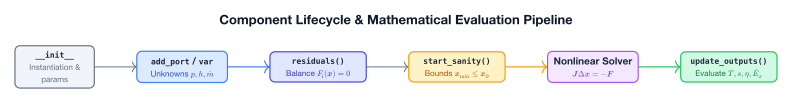

# Component Library Overview

Caldis provides a comprehensive suite of thermal and fluid components grouped into functional categories.

---

## Component Catalog

| Category | Component | Description | Mode |
| :--- | :--- | :--- | :--- |
| **Machines** | [`Compressor`](machines.md) | Adiabatic compressor with isentropic efficiency | Sizing / Sim |
| | [`Turbine`](machines.md) | Adiabatic expansion turbine with isentropic & mechanical efficiency | Sizing / Sim |
| **Heat Exchangers** | [`SizingHX`](heat_exchangers.md) | Single-zone counterflow LMTD heat exchanger for sizing $(UA, A)$ | Sizing |
| | [`RatingHX`](heat_exchangers.md) | Single-zone counterflow LMTD with fixed geometry | Rating |
| | [`HXSim`](heat_exchangers.md) | Discretized 1D finite-volume heat exchanger with wall dynamics | Simulation |
| **Combustion & Heat** | [`CombustionChamber`](combustion.md) | Air + fuel combustion chamber with LHV and pressure drop | Simulation |
| | [`SimpleHeater`](combustion.md) | Single-stream thermal duty element (heater/cooler) | Sizing / Sim |
| **Valves** | [`Valve`](valves.md) | Isenthalpic expansion device (quadratic orifice or linear) | Sizing / Sim |
| **Vessels & Accumulators**| [`ControlVolume`](vessels.md) | 0-D two-phase rigid control volume with mass/energy dynamics | Simulation |
| | [`ControlVolumeP`](vessels.md) | Constant-pressure variable-volume accumulator | Simulation |
| | [`TankConstV`](vessels.md) | Composite tank: `ControlVolume` + `ThermalMass` wall | Simulation |
| | [`TankConstP`](vessels.md) | Composite constant-pressure tank: `ControlVolumeP` + wall | Simulation |
| | [`ThermalMass`](vessels.md) | 0-D thermal capacitance with ambient loss and heat input | Simulation |
| | [`FlashTank`](vessels.md) | Adiabatic flash separator into saturated liquid and vapor | Simulation |
| **Network Fittings** | [`Mixer`](fittings.md) | Constant-pressure adiabatic junction of 2 streams into 1 | Simulation |
| | [`Splitter`](fittings.md) | Division of 1 inlet stream into 2 outlets at identical states | Simulation |
| **Boundaries** | [`FluidBoundary`](sources.md) | General fluid boundary condition (imposing subsets of $p, T, h, \dot{m}$) | Boundary |

---

## Common Component Attributes & Lifecycle

Every component inherits from `caldis.core.component.Component` and participates in the system lifecycle:

- **`ports`**: List of attached `FluidPort` instances.
- **`all_variables()`**: All internal scalar variables plus port variables.
- **`residuals()`**: Array of residuals evaluated during each solver step.
- **`update_outputs()`**: Evaluates post-solve engineering properties (stored in `_outputs` and accessed via `@property`).
- **`start_sanity()`**: Diagnostic checks to warn if the initial start point violates physical constraints.
- **`physical_check()`**: Post-convergence checks (e.g. verifying no temperature crossing in heat exchangers).

