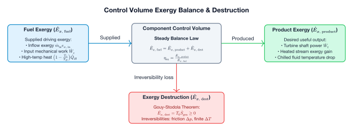

# Second-Law Exergy Analysis

First-law energy balances track energy quantity but ignore energy degradation and irreversibility. Caldis provides built-in second-law exergy analysis at both component and system levels.

---

## The Dead State $(T_0, p_0)$

All physical exergy flows are evaluated relative to an ambient reference (dead) state:

$$e = (h - h_0) - T_0 (s - s_0)$$

$$\dot{X} = \dot{m} \cdot e$$

Where $h_0$ and $s_0$ are the specific enthalpy and entropy evaluated at $(p_0, T_0)$.



---

## Generating an Exergy Report

```python
# 1. Solve the system
sol = solve(sys)

# 2. Set the ambient dead state (e.g. 15 °C, 1.01325 bar)
sys.set_reference(T_ref=288.15, p_ref=101325.0)

# 3. Generate exergy report
exergy_df = sys.exergy_report(as_dataframe=True)
print(exergy_df)
```

### Report Columns

| Column | Definition | Description |
| :--- | :--- | :--- |
| `X_supplied` | Exergy consumed ($\text{W}$) | Shaft work input or fuel exergy provided to component. |
| `X_recovered` | Exergy produced ($\text{W}$) | Useful exergy transferred into stream or shaft power output. |
| `X_destroyed` | Exergy destruction $\dot{X}_d$ ($\text{W}$) | Irreversibility: $\dot{X}_d = T_0 \dot{S}_{\text{gen}} = X_{\text{supplied}} - X_{\text{recovered}}$. |
| `eta_II` | Exergetic efficiency $\eta_{\text{II}}$ | $\eta_{\text{II}} = \frac{X_{\text{recovered}}}{X_{\text{supplied}}}$. |

---

## Component Exergy Formulations

### Turbines & Compressors

**Turbine**:

$$X_{\text{supplied}} = \dot{m} (e_{\text{in}} - e_{\text{out}}), \quad X_{\text{recovered}} = \dot{W}_{\text{shaft}}$$

**Compressor**:

$$X_{\text{supplied}} = |\dot{W}_{\text{shaft}}|, \quad X_{\text{recovered}} = \dot{m} (e_{\text{out}} - e_{\text{in}})$$

### Expansion Valves

Valves are purely dissipative devices:

$$X_{\text{recovered}} = 0, \quad X_{\text{destroyed}} = T_0 \dot{S}_{\text{gen}} = \dot{m} T_0 (s_{\text{out}} - s_{\text{in}})$$

### Heat Exchangers & Heaters
For `SimpleHeater`, the user must provide `T_source` (the temperature of the heat source/sink reservoir). For electric resistance heating, set `T_source = float('inf')`.

