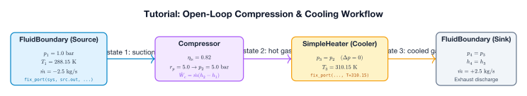

# Getting Started

!!! info "Document Type: Tutorial"
    This is a step-by-step learning guide designed to lead a newcomer through building, configuring, and solving their first thermodynamic system in Caldis.

## What You'll Learn
In this tutorial, you will:

1. Install Caldis and its underlying thermodynamic property libraries.
2. Initialize fluid backends with CoolProp.
3. Build and connect a 4-component open air compression and cooling loop.
4. Close degrees of freedom using `fix_port`.
5. Seed initial guesses with `autostart` and compute the solution.

---

## Prerequisites & Installation

Before starting, ensure you have Python 3.10+ installed. Install Caldis along with the required scientific computing and thermodynamic packages:

```bash
pip install coolprop numpy scipy pandas
pip install -e .
```

---

## The Workflow

We will model a continuous air compression and cooling process:



---

## 1. Imports and Backend Initialization

```python
import numpy as np
from caldis.core.system import System
from caldis.components import FluidBoundary, Compressor, SimpleHeater
from caldis.fluids import CoolPropBackend
from caldis.solvers import solve
from caldis.solvers.autostart import fix_port, autostart

# Use CoolProp for air thermophysical properties
air = CoolPropBackend("Air")
```

---

## 2. Define Components & Connect

```python
p_suction = 1.0e5       # 1 bar
T_suction = 288.15      # 15 °C
mass_flow = 2.5         # 2.5 kg/s

# 1. Source (imposes p, T, mdot)
# Note: mass flow is negative because it leaves the source
src = FluidBoundary("src", p=p_suction, T=T_suction, mdot=-mass_flow, backend=air)

# 2. Compressor (isentropic efficiency 0.85)
comp = Compressor("comp", backend=air, eta_is=0.85)

# 3. Cooler (duty Qdot=None: closed by imposing downstream temperature)
cooler = SimpleHeater("cooler", backend=air, Qdot=None, dp=0.0)

# 4. Sink (unconstrained boundary)
sink = FluidBoundary("sink", backend=air)

# Build system and connect ports
sys = System("compression_test")
sys.add(src, comp, cooler, sink)

sys.connect(src.port, comp.inl)
sys.connect(comp.out, cooler.inl)
sys.connect(cooler.out, sink.port)
```

---

## 3. Impose Design Specifications (`fix_port`)

At this stage, the system has 2 degrees of freedom:
1. The compressor discharge pressure is unconstrained.
2. The cooler duty is unconstrained.

We close both using `fix_port`:

```python
p_discharge = 6.0e5     # 6 bar
T_target = 303.15       # 30 °C

fix_port(sys, comp.out, p=p_discharge)
fix_port(sys, cooler.out, T=T_target)
```

---

## 4. Seed and Solve

```python
# 1. Propagate start values automatically
autostart(sys, verbose=True)

# 2. Run solver (preflight checks DOF -> direct Newton -> homotopy fallback)
sol = solve(sys, verbose=True)

if sol.success:
    print("\n--- RESULTS ---")
    print(f"Compressor Work (absorbed): {comp.Wdot / 1e3:.2f} kW")
    print(f"Compressor Discharge Temp:  {comp.out.T - 273.15:.1f} °C")
    print(f"Cooler Duty (extracted):    {cooler.Qdot / 1e3:.2f} kW")
    print(f"Pressure Ratio:             {comp.pressure_ratio:.2f}")
```

### Tabulating Port States

Caldis provides `sys.port_table()` to format every fluid port into a structured table or Pandas DataFrame:

```python
df = sys.port_table()
print(df[["p_bar", "T_C", "h_kJkg", "mdot"]])
```

