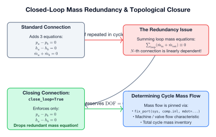
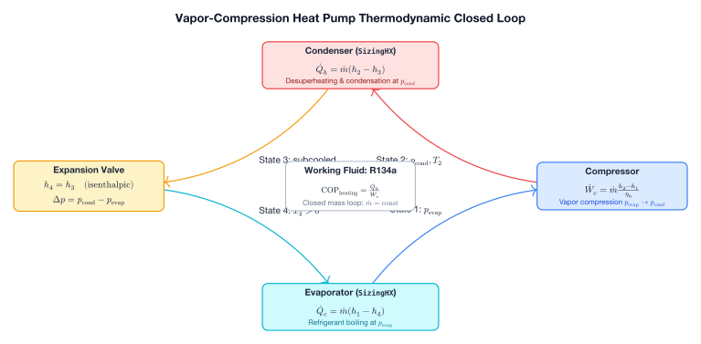

# Closing Closed-Loop Cycles

In open-loop architectures, mass flow enters via a source and exits through a sink. In closed thermodynamic loops (e.g., closed Brayton gas cycles, vapor-compression heat pumps, ORC loops), fluid recirculates indefinitely.

This introduces a fundamental topological issue: **redundant mass conservation**.



---

## The Closed-Loop Redundancy Problem

Consider a simple closed loop connecting four components in series:

$$A \longrightarrow B \longrightarrow C \longrightarrow D \longrightarrow A$$

Every standard connection adds 3 equations:
1. $p_a = p_b$
2. $h_a = h_b$
3. $\dot{m}_a + \dot{m}_b = 0$

Summing mass equations along the loop yields:

$$(\dot{m}_{A,\text{out}} + \dot{m}_{B,\text{in}}) + (\dot{m}_{B,\text{out}} + \dot{m}_{C,\text{in}}) + \dots = 0$$

Because each component already satisfies $\dot{m}_{\text{in}} + \dot{m}_{\text{out}} = 0$, the $N$-th mass connection equation is a linear combination of all preceding mass balances.

If all connections enforce mass conservation, the system will be **over-specified ($\text{DOF} = -1$)**, causing a rank-deficient Jacobian.

---

## The Solution: `close_loop=True`

When wiring the final connection that closes the loop, specify `close_loop=True`:

```python
# Standard connections:
sys.connect(comp.out, heater.inl)
sys.connect(heater.out, turb.inl)
sys.connect(turb.out, cooler.inl)

# CLOSING CONNECTION:
sys.connect(cooler.out, comp.inl, close_loop=True)
```

### What `close_loop=True` Does:
- Enforces pressure continuity: $p_{\text{cooler,out}} - p_{\text{comp,inl}} = 0$
- Enforces enthalpy continuity: $h_{\text{cooler,out}} - h_{\text{comp,inl}} = 0$
- **Drops the redundant mass balance equation**: $\dot{m}$ is left to be determined by the cycle boundary conditions (e.g., total inventory, specified flow rate, or component characteristic curve).

---

## Example: Vapor-Compression Heat Pump Cycle

A canonical closed cycle is the 4-component vapor-compression heat pump:



---

## Setting Mass Flow in a Closed Loop

Because no source imposes flow, you must provide one condition that fixes the flow rate or mass inventory:

### Approach A: Fix Flow Rate on a Machine or Valve
```python
# Fix mass flow rate directly on the compressor inlet
fix_port(sys, comp.inl, mdot=5.0)
```

### Approach B: Fixed Charge / Accumulator
If an accumulator or variable-volume tank is included, the loop pressure and mass distribution adjust dynamically to match the inventory.

