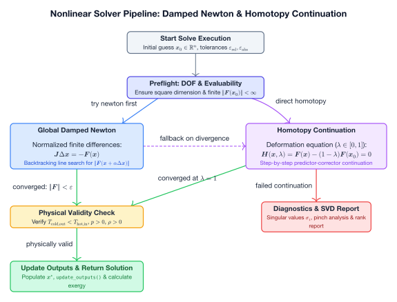

# Steady-State Solvers & Homotopy Continuation

Caldis solves nonlinear algebraic systems $F(x) = 0$ using a multi-stage approach combining damped Newton methods and parameter continuation.

---

## The Unified `solve()` Function

```python
from caldis.solvers import solve

sol = solve(
    system,
    steps=3,
    verbose=True,
    show_homotopy=False,
    diagnostics=True,
    raise_on_fail=False,
    strict_physical=False,
    try_newton_first=True
)
```

### Execution Pipeline




---

## 1. Damped Global Newton (`newton`)

The direct solver uses a bounded, scaled damped Newton algorithm:
- Evaluates the Jacobian $J$ via finite differences normalized by each variable's characteristic `scale`.
- Solves $J \Delta x = -F(x)$.
- Performs backtracking line search to ensure reduction of residual norm $\|F(x)\|$.
- Enforces variable lower and upper bounds (`v.lower`, `v.upper`).

---

## 2. Homotopy Continuation (`solve_homotopy`)

When direct Newton fails due to highly nonlinear start points, Caldis falls back to **homotopy continuation**:

$$H(x, \lambda) = F(x) - (1 - \lambda) F(x_0) = 0, \quad \lambda \in [0, 1]$$

- At $\lambda = 0$: $H(x_0, 0) = 0$ is trivially satisfied by the initial guess $x_0$.
- The continuation parameter $\lambda$ is stepped from $0 \rightarrow 1$ across $N$ steps (`steps=3` by default).
- Each step uses the solution of the previous step as its starting point.
- At $\lambda = 1$: $H(x, 1) = F(x) = 0$, recovering the true solution.

---

## Post-Solve Physical Verification

A solution can converge mathematically while being physically impossible (e.g., negative temperature approaches where heat flows from cold to hot).

After convergence, `solve()` runs `system.physical_check()`.
- If violations exist (such as temperature crossings), warnings are printed.
- If `strict_physical=True`, `sol.success` is flipped to `False`.

